    <h3><code>bjorkgard@github ~ $ ./contributions.sh</code></h3>
    
      
    <h3><code>bjorkgard@github ~ $ whoami</code></h3>
    <table>
        <tr>
            <td valign="top"></td>
            <td valign="top"></td>
        </tr>
    </table>
      
    <h3><code>bjorkgard@github ~ $ ./links.sh</code></h3>
    
<b>Fullstack Developer</b>
    

